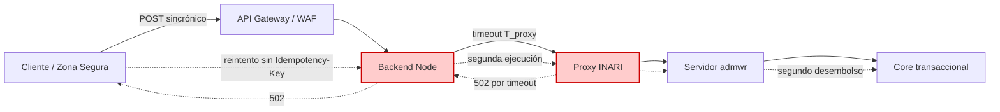
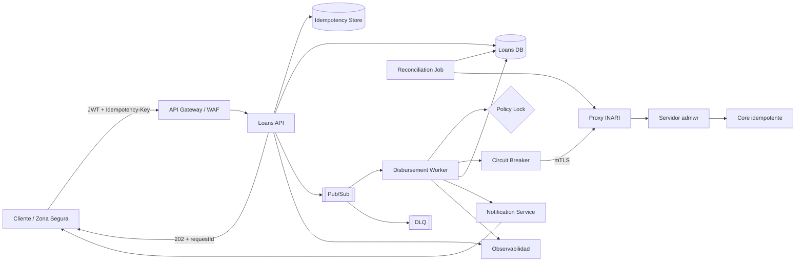

# Reto 3 — Arquitectura: Préstamos de Renta Particular

> Documento de arquitectura AS-IS / TO-BE para el proceso de desembolso de
> préstamos de renta particular de Interseguritos. El objetivo no es "dibujar
> microservicios", sino eliminar la duplicidad de desembolsos y desacoplar la
> experiencia del cliente de la latencia de VMWARE INARI.

---

## 0. Resumen ejecutivo

El problema no es que INARI sea lento. El problema es que el flujo actual tiene
tres fallos estructurales que convierten una lentitud normal en un doble
desembolso:

1. **Acoplamiento UX ↔ latencia:** la pantalla del cliente está atada a la
   respuesta sincrónica de un sistema interno que puede tardar y, aun así,
   completar la operación.
2. **Ausencia de idempotencia:** el backend no puede distinguir un reintento
   del mismo préstamo de una solicitud nueva.
3. **Ausencia de estado y reconciliación:** no existe una máquina de estados
   consultable ni un proceso que resuelva transacciones que quedaron colgadas.

El 502 del proxy es un **síntoma** del primer fallo. La duplicidad es el
**efecto** del segundo. La opacidad operativa es el **efecto** del tercero.

La solución TO-BE es **asíncrona, idempotente y reconciliable**. El cliente
recibe `202 Accepted` con un `requestId`, consulta el estado y el desembolso se
procesa en un worker con idempotencia, lock por póliza, circuit breaker,
reintentos seguros y compensación.

---

## PARTE A — Diagnóstico (causa raíz, no síntomas)

### A.1 Validación de la hipótesis de partida

La hipótesis planteada es correcta en su dirección, pero conviene precisarla:

- **El 502 es un síntoma, no la causa.** El proxy traduce un timeout del
  backend (`admwr`) en un `502 Bad Gateway`. Es decir, el proxy no sabe si la
  operación se ejecutó o no: solo sabe que no obtuvo respuesta a tiempo.
- **La causa raíz es la combinación de sincronía + falta de idempotencia +
  falta de estado.** Cualquiera de las tres por separado no produce el
  desastre; juntas sí:
  - La sincronía permite que el cliente reintente mientras el backend sigue
    trabajando.
  - La falta de idempotencia permite que el reintento se ejecute como una
    operación nueva.
  - La falta de estado impide saber, a posteriori, cuál de las ejecuciones es
    la válida.

### A.2 Refinamiento: el fallo es de contrato, no solo de infraestructura

El contrato actual es **"ejecutar y responder en la misma llamada"**. Ese
contrato es imposible de cumplir de forma segura cuando el sistema de destino
puede tardar más que el timeout del proxy. En términos de arquitectura:

> Un timeout no significa "no se ejecutó"; significa "no sé si se ejecutó".
> Sin idempotencia, esa ambigüedad se convierte en duplicidad.

### A.3 Los tres fallos estructurales

| # | Fallo | Descripción | Consecuencia |
|---|-------|-------------|--------------|
| 1 | **Acoplamiento UX ↔ latencia** | El cliente espera la confirmación de INARI en pantalla. El proxy corta a los N segundos, pero `admwr` sigue procesando. | El cliente percibe fallo aunque el desembolso pueda completarse. |
| 2 | **Ausencia de idempotencia** | No existe una clave única por solicitud (`policyNumber` + `customerId` + intento). Cada reintento del cliente crea una nueva ejecución. | Doble o múltiple desembolso para la misma póliza/cliente. |
| 3 | **Ausencia de estado y reconciliación** | La solicitud no se persiste con estados `PENDING / COMPLETED / FAILED`; no hay job que resuelva las colgadas. | No se puede detectar ni corregir la duplicidad; se depende de revisión manual. |

### A.4 Por qué el reintento del cliente es "racional" pero destructivo

El cliente no tiene forma de saber si el préstamo se ejecutó. Ante un 502, la
acción correcta desde su punto de vista es reintentar. El sistema, al no tener
idempotencia, interpreta ese reintento como una nueva intención de negocio. El
fallo no es del cliente: es del contrato del API, que no ofrece una operación
segura de reintento.

### A.5 Síntomas observados vs. causas

| Síntoma observado | Causa raíz asociada |
|---|---|
| 502 en el proxy | Timeout del proxy sobre `admwr` (síntoma de acoplamiento y timeouts mal calibrados). |
| El cliente reintenta | No hay `requestId` ni estado consultable; el cliente no puede saber el resultado. |
| Se desembolsa dos veces | Falta de clave de idempotencia y de lock por póliza. |
| Operaciones "fantasma" | `admwr` sigue ejecutando después de que el proxy ya respondió 502. |
| Reclamos operativos | No hay traza correlacionada ni reconciliación automática. |

---

## PARTE B — Diseño AS-IS (para draw.io)

### B.1 Componentes

1. **Cliente / Zona Segura (SPA).** Pantalla de solicitud de préstamo; espera
   confirmación sincrónica.
2. **API Gateway / WAF.** Expone el backend Node; aplica autenticación y
   enrutamiento.
3. **Backend Node (orquestador).** Recibe la solicitud, llama al proxy de INARI
   y espera la respuesta para responder al cliente.
4. **Proxy INARI.** Reenvía la petición a `admwr`; aplica un timeout y
   devuelve `502` cuando se supera.
5. **Servidor admwr (VMWARE INARI).** Procesa el préstamo en segundo plano;
   puede completar aunque el proxy ya haya respondido 502.
6. **Core transaccional / AS400.** Ejecuta el movimiento de desembolso.
7. **BD de solicitudes (sin idempotencia).** Registra la solicitud sin clave
   única que impida reintentos duplicados.

### B.2 Conexiones y flujo

```
Cliente (Zona Segura)
   │  1. POST /loans/disburse (sincrónico, espera en pantalla)
   ▼
API Gateway / WAF
   │  2. forward
   ▼
Backend Node (orquestador)
   │  3. POST /inari/disburse (timeout = T_proxy)
   ▼
Proxy INARI
   │  4. forward
   ▼
Servidor admwr (VMWARE INARI)
   │  5. execute (latencia > T_proxy)
   ▼
Core transaccional / AS400
   │  6. desembolso ejecutado
   ▲
   │  7. respuesta lenta
Proxy INARI ── 8. timeout → 502 ──► Backend Node ── 9. 502 ──► Cliente
                                                          │
                                         10. el cliente reintenta
                                                          ▼
                                      Backend Node → Proxy → admwr → Core
                                                  (segundo desembolso)
```

### B.3 Punto exacto de fallo

El punto de fallo está en la **frontera entre el Proxy INARI y el Backend
Node**, cuando el timeout del proxy (`T_proxy`) es menor que el tiempo de
procesamiento de `admwr` (`T_admwr`). En ese instante:

- El proxy ya no puede esperar y responde 502.
- `admwr` no se entera de que el cliente recibió un error y continúa.
- El cliente reintenta sin una clave que permita deduplicar.
- El core ejecuta un segundo desembolso.

**Zona de peligro:** `T_proxy < T_admwr`. La operación queda en estado
"posiblemente ejecutada pero no confirmada".

### B.4 Por qué el AS-IS no se arregla solo subiendo el timeout

Subir el timeout reduce la probabilidad del 502, pero no elimina el problema:
siempre existirá una latencia mayor que cualquier timeout fijo. Además, un
timeout más alto empeora la experiencia del cliente y consume conexiones del
proxy. La solución debe ser **idempotente y asíncrona**, no solo "más
paciente".

---

## PARTE C — Diseño TO-BE (arquitectura objetivo)

### C.1 Principios de diseño

1. **Aceptar rápido, procesar aparte.** El API responde `202 Accepted` con un
   `requestId`; el cliente consulta el estado.
2. **Idempotencia en el borde y en el worker.** La misma `Idempotency-Key`
   produce el mismo resultado; el segundo intento no vuelve a ejecutar.
3. **Estado explícito y persistido.** `PENDING → PROCESSING → COMPLETED |
   FAILED | COMPENSATED`.
4. **Reintentos solo donde son seguros.** Backoff exponencial con jitter
   únicamente sobre operaciones idempotentes.
5. **Reconciliación automática.** Un job resuelve transacciones `PENDING`
   colgadas consultando a INARI por `correlationId`.
6. **Seguridad en profundidad.** JWT en el borde, mTLS hacia INARI, secretos
   gestionados, sin exponer `admwr` directamente.

### C.2 Componentes y responsabilidad (una línea cada uno)

| Componente | Responsabilidad | Síntoma AS-IS que resuelve |
|---|---|---|
| **Cliente / Zona Segura (SPA)** | Enviar la solicitud y consultar el estado por `requestId`; nunca espera a INARI. | Acoplamiento UX ↔ latencia. |
| **API Gateway / WAF** | Autenticar (JWT), aplicar rate limit, validar tamaño y enrutar al Loans API. | Exposición directa y abuso; seguridad. |
| **Loans API (Node)** | Validar el contrato, exigir `Idempotency-Key`, persistir la solicitud y responder `202 Accepted`. | Reintentos destructivos y falta de estado. |
| **Idempotency Store (Redis / Memorystore)** | Guardar `Idempotency-Key → requestId + hash del payload + estado` con TTL. | Doble desembolso por reintento. |
| **Loans DB (PostgreSQL)** | Persistir la máquina de estados, el `requestId`, `correlationId`, intentos y resultados. | Falta de trazabilidad y reconciliación. |
| **Policy Lock (Redis lock)** | Lock distribuido por `policyNumber`/`customerId` para serializar intentos concurrentes. | Control de concurrencia. |
| **Pub/Sub (o cola gestionada)** | Desacoplar la aceptación de la ejecución; bufferizar picos; reintentos y DLQ. | Acoplamiento temporal y picos de latencia. |
| **Disbursement Worker (Cloud Run)** | Consumir el mensaje, ejecutar el desembolso con idempotencia y actualizar estado. | Procesamiento en segundo plano controlado. |
| **Circuit Breaker + Retry Policy** | Cortar llamadas a INARI cuando falla, evitar cascadas y reintentar con backoff + jitter. | Timeouts y fallos en cascada. |
| **Proxy INARI (mTLS)** | Único punto de salida hacia `admwr`; timeout calibrado y propagación de `correlationId`. | Exposición y timeouts inconsistentes. |
| **Servidor admwr / Core** | Ejecutar el desembolso de forma idempotente usando `correlationId`. | Duplicidad en el destino. |
| **Notification Service** | Notificar al cliente (push/email/SSE) cuando el estado cambie. | Cliente sin confirmación. |
| **Reconciliation Job (Cloud Scheduler)** | Buscar `PENDING` antiguos y conciliar contra INARI por `correlationId`. | Transacciones colgadas. |
| **Dead Letter Queue (DLQ)** | Retener mensajes que agotaron reintentos para análisis y reproceso manual. | Pérdida silenciosa de solicitudes. |
| **Observabilidad (logs, métricas, trazas)** | Correlacionar `requestId`/`correlationId` de extremo a extremo. | Diagnóstico manual y lento. |
| **Secrets Manager / KMS** | Gestionar credenciales, claves JWT y certificados mTLS. | Seguridad de secretos. |

### C.3 Flujo TO-BE (camino feliz)

```
Cliente
  │  POST /v1/loans/disbursements
  │  Headers: Authorization: Bearer <JWT>, Idempotency-Key: <policy+customer+attempt>
  ▼
API Gateway ──► Loans API
                  │ 1. valida JWT + contrato
                  │ 2. consulta Idempotency Store
                  │      ├─ existe y COMPLETED → 200 con resultado previo
                  │      ├─ existe y PENDING   → 202 con el mismo requestId
                  │      └─ no existe          → crea PENDING + publica evento
                  │ 3. persiste en Loans DB (PENDING)
                  │ 4. publica en Pub/Sub
                  ▼
            202 Accepted { requestId, statusUrl }
                  │
                  ▼
        Pub/Sub topic: disbursement-requests
                  │
                  ▼
        Disbursement Worker
          │ 1. adquiere lock por policyNumber
          │ 2. verifica idempotencia (correlationId)
          │ 3. llama a INARI vía Circuit Breaker + mTLS
          │ 4. actualiza estado: PROCESSING → COMPLETED / FAILED
          │ 5. publica evento de resultado
          ▼
        Loan DB (COMPLETED) + Notification Service
                  │
                  ▼
        Cliente consulta GET /v1/loans/disbursements/{requestId}
        (o recibe notificación push/SSE)
```

### C.4 Flujo TO-BE (timeout / 502 de INARI)

```
Worker ──► Circuit Breaker ──► Proxy INARI ──► admwr
   │                              │
   │                              └─ timeout → 502
   │
   ├─ El worker NO marca FAILED de inmediato: marca PROCESSING/UNKNOWN
   ├─ Reintenta con backoff + jitter (la operación es idempotente por correlationId)
   ├─ Si se agota el presupuesto → estado PENDING_REVIEW + alerta
   └─ Reconciliation Job consulta a INARI por correlationId:
         ├─ INARI confirma ejecución → COMPLETED (sin re-ejecutar)
         └─ INARI confirma no ejecución → reintento seguro o FAILED
```

### C.5 Idempotencia (el corazón de la solución)

**Clave de idempotencia:** `policyNumber + customerId + intento lógico`.

Reglas:

1. El cliente debe enviar `Idempotency-Key`. Si no la envía, el API genera una
   a partir del hash del payload + ventana temporal, pero **no se acepta un
   reintento como nueva solicitud**.
2. El `Idempotency Store` guarda:
   - `key` → `requestId`
   - `payloadHash` (SHA-256 del body canónico)
   - `state` (`PENDING`, `PROCESSING`, `COMPLETED`, `FAILED`)
   - `response` (resultado final, para devolverlo en reintentos)
3. Si llega una solicitud con la misma key:
   - Mismo `payloadHash` + `COMPLETED` → **200 con el resultado previo**.
   - Mismo `payloadHash` + `PENDING` → **202 con el mismo `requestId`**.
   - Distinto `payloadHash` → **409 Conflict** (la key ya se usó con otro
     contenido).
4. En el destino (`admwr`), se envía `correlationId` y se exige que el core
   sea idempotente por ese identificador. Si el core no lo soporta, el worker
   mantiene una tabla de conciliación local y nunca reenvía dos veces el mismo
   `correlationId` sin confirmación.

### C.6 Control de concurrencia

- **Lock distribuido** por `policyNumber` con TTL (Redis `SET NX PX`), para
  evitar que dos workers procesen simultáneamente la misma póliza.
- **Constraint único** en BD: `(policy_number, customer_id, idempotency_key)`.
- **Optimistic locking** (`version` column) en la tabla de solicitudes para
  detectar actualizaciones concurrentes.
- El lock se libera al terminar o al vencer el TTL; la reconciliación cubre el
  caso de worker caído.

### C.7 Resiliencia y reintentos

- **Timeouts calibrados por capa:** cliente > gateway > API > worker > INARI.
  Nunca un timeout interno mayor que el del cliente que lo invoca.
- **Circuit Breaker** hacia INARI: abre tras N fallos, half-open con prueba
  controlada, cierra al recuperarse.
- **Retry con backoff exponencial + jitter**, solo para operaciones
  idempotentes y errores transitorios (timeout, 502, 503). **No** se reintentan
  errores 4xx de negocio.
- **Bulkhead:** pool de workers separado por tipo de operación para que un
  pico de préstamos no bloquee otros flujos.
- **DLQ:** mensajes que agotan reintentos se derivan a una cola muerta con
  alerta y herramienta de reproceso.

### C.8 Saga y compensación

El desembolso puede tener pasos posteriores (notificación, actualización de
póliza, contabilidad). Si un paso posterior falla:

1. El desembolso **no se revierte automáticamente** (devolver dinero es una
   operación sensible y regulada).
2. Se marca `COMPENSATION_REQUIRED` y se dispara una **saga de compensación**
   con aprobación humana/operativa.
3. La compensación es **idempotente** y auditada; si no es posible, se genera
   un caso operativo con toda la traza.
4. Alternativa preferida: **evitar la saga** haciendo que la notificación sea
   un efecto secundario reintentable (outbox pattern + evento), no un paso
   crítico del desembolso.

### C.9 Máquina de estados

```
PENDING ──► PROCESSING ──► COMPLETED
   │              │
   │              ├──► FAILED (error definitivo, no reintentable)
   │              ├──► PENDING_RETRY (error transitorio, backoff)
   │              └──► PENDING_REVIEW (timeout ambiguo → reconciliación)
   │
   └──► EXPIRED (sin procesar dentro de la ventana)
```

Estados persistidos en `Loans DB` con `requestId`, `correlationId`,
`idempotencyKey`, `attempts`, `lastError`, `updatedAt`.

### C.10 Reconciliación

- **Cloud Scheduler** ejecuta cada N minutos un job que busca solicitudes en
  `PROCESSING`/`PENDING_REVIEW` con `updatedAt` mayor a un umbral.
- El job consulta a INARI por `correlationId` (endpoint de consulta o
  extracto) y decide:
  - Ejecutado → `COMPLETED`.
  - No ejecutado → reintento seguro o `FAILED`.
  - Desconocido → alerta a operaciones, sin re-ejecutar.
- Toda decisión queda auditada.

### C.11 Seguridad

- **JWT en el borde:** el API Gateway valida firma, expiración, audiencia y
  scopes. El cliente nunca habla directo con INARI.
- **mTLS hacia INARI:** certificados gestionados, rotación automática, Zero
  Trust. `admwr` no se expone a la red pública.
- **Secretos** en Secret Manager / KMS; nunca en variables planas del repo.
- **Cifrado** en tránsito (TLS 1.2+) y en reposo (KMS).
- **Autorización por rol:** solo roles de operaciones pueden consultar
  solicitudes de otros clientes; el cliente solo ve las propias.
- **Auditoría inmutable** de cada cambio de estado (quién, cuándo, qué).
- **Rate limiting** y validación de payload para evitar abuso.

---

## PARTE D — Justificación de decisiones (criterios del evaluador)

### D.1 Escalabilidad

- **Loans API** es stateless: escala horizontalmente detrás del gateway. La
  sesión y la idempotencia viven en Redis/DB, no en memoria local.
- **Workers** escalan por profundidad de cola (Pub/Sub + Cloud Run con
  autoescalado a cero). Los picos se absorben en la cola, no en la pantalla
  del cliente.
- **PostgreSQL** escala verticalmente al inicio y luego con réplicas de
  lectura/particionado por fecha. El volumen de desembolsos no justifica
  sharding prematuro.
- **Redis** se usa para idempotencia y locks; es un almacén clave-valor con
  TTL, no una fuente de verdad.

### D.2 Resiliencia y reintentos

- Los reintentos son seguros **porque la operación es idempotente**: la misma
  `Idempotency-Key`/`correlationId` no genera un segundo desembolso.
- El circuit breaker evita que un INARI degradado arrastre al resto del
  sistema.
- Los timeouts se calibran de afuera hacia adentro; el cliente siempre recibe
  una respuesta rápida (`202`), aunque el procesamiento tarde.
- La DLQ y la reconciliación garantizan que ningún mensaje se pierda en
  silencio.

### D.3 Control de concurrencia

- **Lock por póliza** + **unique constraint** + **optimistic locking** cubren
  tres niveles: aplicación distribuida, base de datos y actualización
  concurrente.
- El lock tiene TTL para evitar deadlocks si un worker muere.
- La reconciliación detecta y resuelve el caso de worker caído.

### D.4 Seguridad

- **JWT** protege el borde: identifica al cliente y sus scopes.
- **mTLS** protege la comunicación interna hacia INARI y evita suplantación.
- **Secret Manager** evita secretos en el repositorio.
- **Auditoría** permite responder a requerimientos regulatorios y de fraude.
- **Menor privilegio:** cada servicio tiene solo los permisos que necesita.

### D.5 Costo de implementación (la decisión proporcional)

**No se propone Kafka + Kubernetes + malla de microservicios** por las
siguientes razones:

1. **Volumen:** el número de desembolsos de renta particular es bajo/moderado
   comparado con un core transaccional masivo. Kafka + K8s introduce costo
   fijo (clústeres, operación, especialistas) que no se justifica.
2. **Time-to-market:** el problema es de contrato y de idempotencia, no de
   throughput. Se resuelve con componentes gestionados y un worker simple.
3. **Costo operativo:** Cloud Run escala a cero; Pub/Sub cobra por mensaje;
   Memorystore/Redis básico y PostgreSQL gestionado tienen costo acotado.
   Kafka + K8s exige personal 24/7 y capacidad ociosa.
4. **Complejidad accidental:** una malla de microservicios para un solo flujo
   multiplica los puntos de fallo y las decisiones de consistencia.

**Propuesta proporcional:**

- **API Gateway gestionado** (o Cloud Endpoints) para JWT/rate limit.
- **Cloud Run** para Loans API y Worker (contenedores, autoscaling, pago por
  uso).
- **Pub/Sub** como cola gestionada con reintentos y DLQ.
- **Cloud SQL PostgreSQL** para estado.
- **Memorystore Redis** para idempotencia y locks.
- **Cloud Scheduler** para reconciliación.
- **Secret Manager + mTLS** para seguridad.

#### Comparación de costo (orden de magnitud, tráfico bajo/medio)

| Componente | Opción A (elegida) — proporcional | Opción B (descartada) — Kafka + K8s |
|---|---|---|
| Ingesta / cola | **Cloud Pub/Sub**: ~$0.04 por millón de mensajes | **Confluent Cloud Kafka**: desde ~$250/mes (cluster básico) |
| Procesamiento | **Cloud Run** (scale-to-zero): ~$0–15/mes con poco tráfico | **GKE Autopilot**: ~$70/mes de base + nodos |
| Base de estado | **Cloud SQL Postgres** pequeño: ~$10–25/mes | PostgreSQL gestionado en clúster: ~$100+/mes |
| Observabilidad | Cloud Logging/Monitoring (incluido, capas gratuitas) | Stack propio en K8s: ~$30–50/mes |
| Operación | **Serverless, sin servidores ni equipo SRE** | Requiere equipo de plataforma dedicado |
| **Total estimado** | **~$15–50/mes** | **~$450–500/mes** |

> Diseñé para el volumen real, no para el volumen imaginado. Pub/Sub + Cloud Run
> resuelve el problema con ~10% del costo de un stack Kafka/K8s; añadir
> complejidad sin demanda es deuda técnica disfrazada de escalabilidad.

> Menos puede ser más: la arquitectura más barata es la que no hay que
> operar. Si el volumen crece 100x, se puede migrar a Kafka/K8s con el mismo
> contrato de eventos; la decisión es reversible.

### D.6 Trade-offs

| Decisión | Sacrificio | Por qué es aceptable |
|---|---|---|
| Asíncrono con `202` + polling/notificación | El cliente no ve el resultado en la misma llamada. | La UX puede mostrar "procesando" y notificar; es preferible a un 502 ambiguo. |
| Idempotency Store con TTL | Ventana limitada de deduplicación. | La ventana cubre reintentos humanos y de red; la BD mantiene el registro permanente. |
| Reintentos solo en operaciones idempotentes | No se reintentan operaciones no idempotentes. | Se rediseñan para serlo o se derivan a revisión manual. |
| Saga con compensación humana | No hay rollback automático del dinero. | Devolver dinero automáticamente es más riesgoso; se audita y se resuelve con control. |
| PostgreSQL + Redis gestionados | Dependencia de proveedor. | Reduce carga operativa; se puede migrar con estándares abiertos. |
| Cloud Run + Pub/Sub en vez de Kafka/K8s | Menos control fino y menor ecosistema. | El volumen no justifica la complejidad; el contrato de eventos permite migrar. |

---

## PARTE E — Salida para draw.io y README

### E.1 Cómo trasladar a draw.io

Ambos diagramas están versionados en este mismo directorio como XML de
draw.io sin comprimir, por lo que se abren y editan directamente (no son
capturas ni imágenes).

- **AS-IS:** usar [`as-is.drawio`](./as-is.drawio). Contiene los 7 nodos del
  flujo actual, el punto de fallo marcado en rojo y la arista de reintento.
- **TO-BE:** usar [`to-be.drawio`](./to-be.drawio). Contiene el flujo
  asíncrono, idempotencia, lock, Pub/Sub, worker, circuit breaker, DLQ,
  reconciliación y observabilidad.
- Si se prefiere editar en la web, abrir <https://app.diagrams.net> y arrastrar
  el archivo `.drawio`.

### E.2 Diagramas Mermaid (fallback legible en GitHub)

**AS-IS**



**TO-BE**



### E.3 Mensaje para el README

> El 502 es un síntoma. La causa raíz es un contrato sincrónico sin
> idempotencia ni estado. La solución no es "esperar más", sino **aceptar
> rápido, deduplicar por clave, procesar aparte y reconciliar**. Se prioriza
> una arquitectura proporcional (Cloud Run + Pub/Sub + PostgreSQL + Redis)
> sobre Kafka/K8s porque el volumen no justifica el costo operativo y porque
> el problema es de contrato, no de throughput.
